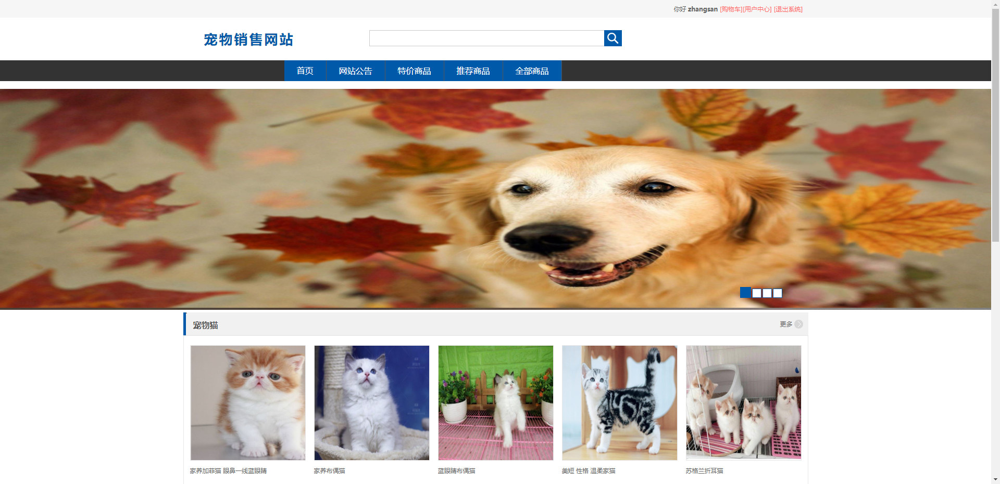
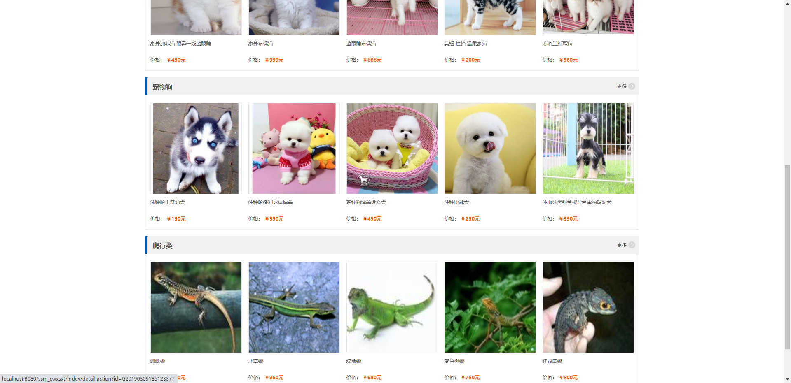
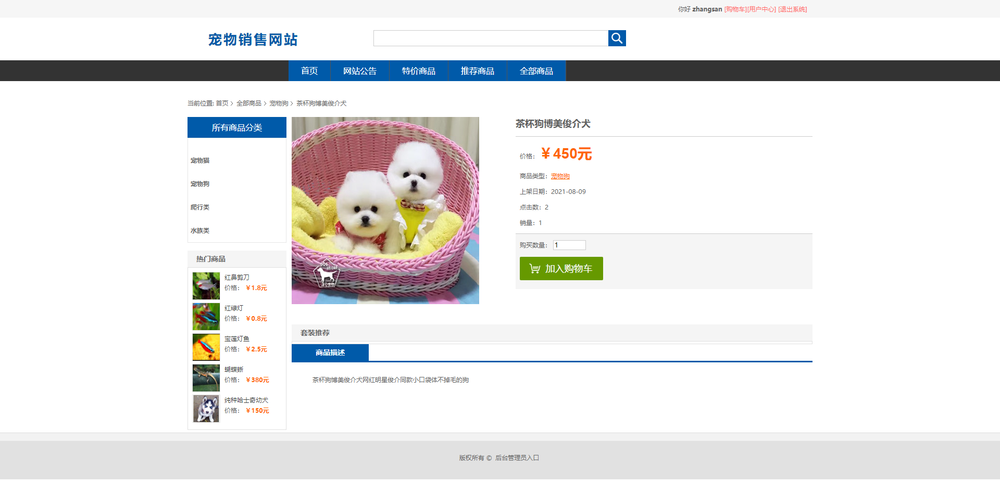
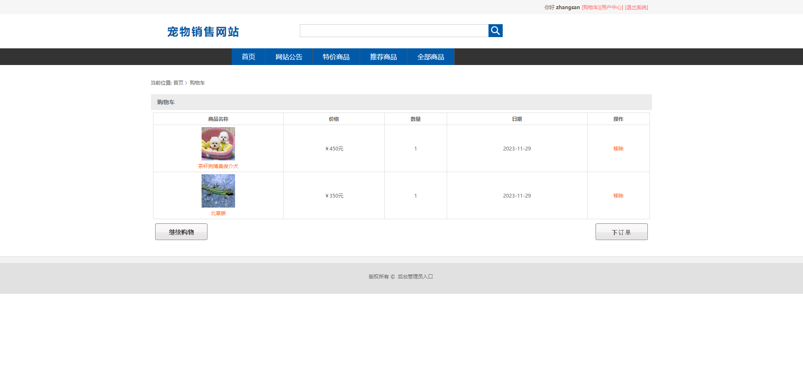
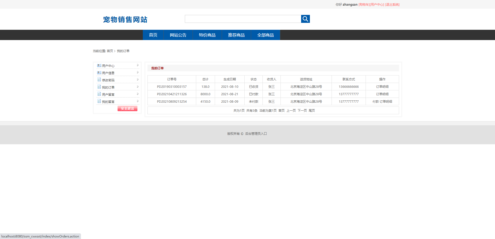
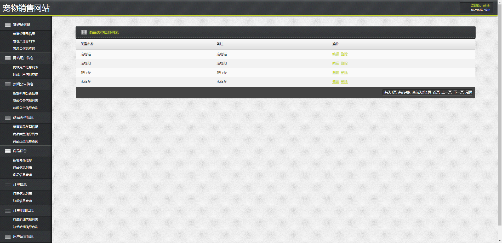
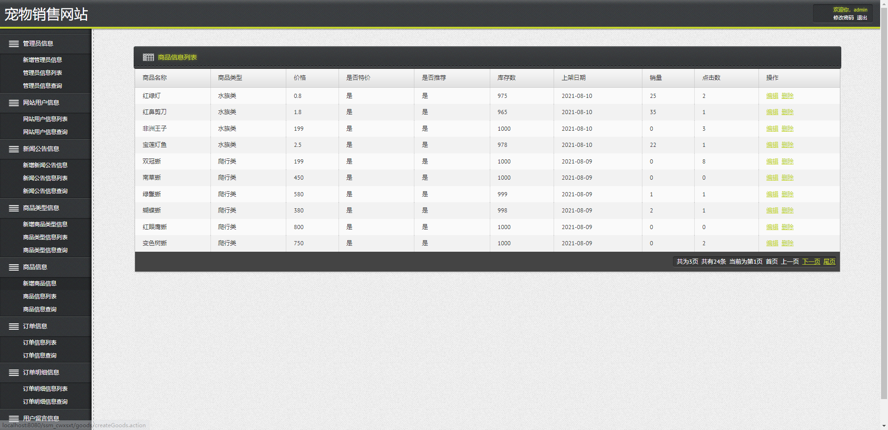
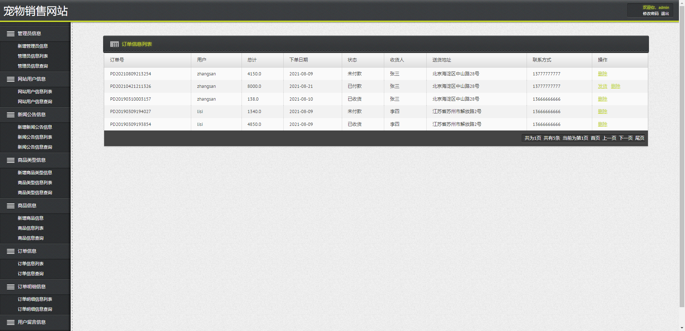
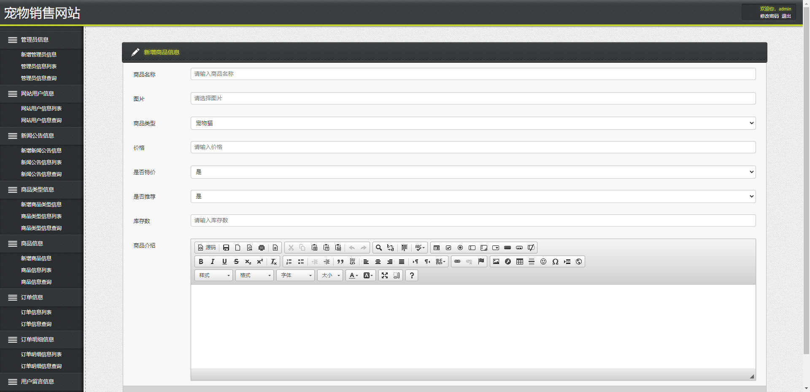

# -- 全局占位符：将 {SITE_URL} 替换为正式站点地址 -->（Java）— 完整源码 + 数据库脚本 + 运行说明
# 宠物销售网站_ssm+jsp

本商品为「宠物销售网站_ssm+jsp」，基于 SSM 技术栈开发。

## 👉 完整项目 / 演示录屏 / 更多项目：{SITE_URL}

## ✨ 功能清单

- 前台用户界面主要是分为：
- 后台主要是管理员对网站信息的添加，更新、删除和查询。

## 🛠 技术栈

- 技术栈信息见项目构建文件

## 📁 目录结构

```
chong-wu-xiao-shou-wang-zhan-ssm-jsp-ssm/
├── db/
│   └── ssm_cwxsxt.sql
├── docs/
│   ├── DESENSITIZE.md
│   └── REVIEW.md
├── ssm_cwxsxt/
│   ├── .settings/
│   ├── classes/
│   ├── src/
│   ├── web/
│   ├── WebContent/
│   ├── .classpath
│   ├── .project
│   └── ReadMe.txt
├── 运行截图/
│   ├── 1.png
│   ├── 2.png
│   ├── 3.png
│   ├── 4.png
│   ├── 5.png
│   ├── 6.png
│   ├── 7.png
│   ├── 8.png
│   └── 9.png
└── 运行必读.txt
```

## 🚀 快速开始

### 环境要求
- JDK 1.8+（以 `pom.xml` 为准）
- Maven 3.x
- MySQL 5.7+ / 8.x

### 步骤
1. 克隆本仓库
2. 用 IDE 打开项目根目录（含 `pom.xml` / `package.json`）
3. 导入 `db/` 或根目录下的 `*.sql` 到 MySQL
4. 修改 `src/main/resources/application.yml`（或 `.properties`）中的数据库账号密码
5. 启动主启动类（`*Application.java`）或执行 `mvn spring-boot:run`
6. 浏览器访问 `http://localhost:8080`

### 端口
- `8080`

### 账号
- 默认账号请查看 运行必读.txt 或数据库初始化数据（常见 admin/admin）

## 📸 截图











## ❓ 常见问题

**跑不起来？**
- 确认 JDK / Maven / MySQL 版本与运行必读一致；先能编译通过再启动。

**端口占用？**
- 修改 `server.port`，或关闭占用 8080 的进程。

**数据库连接失败？**
- 检查库名是否已创建、账号密码、时区与 `allowPublicKeyRetrieval` 等 JDBC 参数。

## 📚 更多开源项目

完整清单见仓库内 [`PROJECTS.md`](./PROJECTS.md)。

## 免责声明与许可

- 本仓库仅供学习交流，不包含商业授权。
- 源码来源于教学/毕设实践整理，使用风险自负。
- 转载请注明出处；请勿用于非法用途。
- 详见 [`LICENSE`](./LICENSE)。

---

**更多完整项目 → {SITE_URL}**